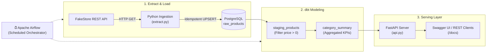

# E-Commerce ETL Platform

[](https://www.python.org/)
[](https://fastapi.tiangolo.com/)
[](https://www.postgresql.org/)
[](https://www.getdbt.com/)
[](https://airflow.apache.org/)
[](https://www.docker.com/)
[](https://docs.pytest.org/)
[](https://opensource.org/licenses/MIT)

An end-to-end, automated **Modern Data Stack (MDS)** ELT pipeline. Ingests e-commerce catalog data from a public REST API into PostgreSQL, transforms and aggregates metrics using **dbt**, schedules and orchestrates runs with **Apache Airflow**, and serves analytical insights via a high-performance **FastAPI** service.

---

## 🌟 Key Features

* **Resilient Ingestion Engine**:
  * Extracts catalog products from FakeStore REST API with network timeouts and error handling.
  * Auto-provisions PostgreSQL tables and runs idempotent **UPSERTs** (`ON CONFLICT (id) DO UPDATE ...`) to prevent duplicate data on pipeline reruns.
* **Modern Transformations (dbt)**:
  * Decouples raw data from analytical reporting.
  * Materializes clean views (`staging_products`) and aggregated business tables (`category_summary`).
  * Automated data quality assertions (`unique`, `not_null`) configured in `schema.yml`.
* **Automated Orchestration (Apache Airflow)**:
  * Multi-stage DAG (`ecommerce_elt_pipeline`) scheduling daily runs.
  * Task dependencies: `extract_and_load >> transform_analytics >> validate_data_quality`.
  * Built-in data quality gate ensuring transformed tables contain active records.
* **Production Analytics API (FastAPI)**:
  * Strongly-typed Pydantic schemas for request validation and response serialization.
  * `/category-summary`: Average price and product count per category.
  * `/products`: Catalog query with category filtering and pagination (`limit`, `offset`).
  * `/health`: Liveness probe verifying active PostgreSQL database connectivity.
* **Dual Execution Modes**:
  * **Local Quickstart**: Run the full pipeline in 5 seconds via `scripts/run_pipeline.py`.
  * **Full Docker Orchestration**: Multi-container stack with Airflow, Redis, PostgreSQL, and FastAPI.

---

## 🏛️ System Architecture



---

## 📂 Project Structure

```
etl-platform/
├── .github/
│   └── workflows/
│       └── ci.yml                 # Automated testing on push/PR
├── dags/
│   └── etl_dag.py                 # Multi-stage Airflow DAG
├── etl_transforms/               # dbt Core project
│   ├── models/
│   │   ├── staging_products.sql   # Filtered & sanitized product view
│   │   ├── category_summary.sql   # Aggregated metrics by category
│   │   └── schema.yml             # dbt documentation & schema tests
│   └── dbt_project.yml
├── scripts/
│   └── run_pipeline.py            # 1-command standalone local runner
├── tests/
│   └── test_pipeline.py           # Pytest suite (API, Pydantic, ingestion)
├── .env.example                   # Environment configuration template
├── .gitignore                     # Git ignore rules
├── api.py                         # FastAPI analytics & catalog endpoints
├── docker-compose.yaml            # Airflow, PostgreSQL, Redis & FastAPI stack
├── Dockerfile                     # Container definition for FastAPI API
├── extract.py                     # Extractor & loader with UPSERT logic
├── pytest.ini                     # Test configuration
├── requirements.txt               # Dependencies
└── README.md
```

---

## 🚀 Quickstart

### 1. Prerequisites
- Python 3.10+
- PostgreSQL database (or Docker)

### 2. Setup Environment
```bash
# Clone the repository
git clone https://github.com/mohammedben10/etl-platform.git
cd etl-platform

# Create and activate virtual environment
python -m venv .venv
source .venv/bin/activate       # On Linux/macOS
# or: .\.venv\Scripts\Activate.ps1 # On Windows

# Install dependencies
pip install -r requirements.txt

# Copy environment settings
cp .env.example .env
```

### 3. Run Pipeline (Local Mode - 5 Seconds)
Run the complete extract, load, and transform workflow in one command:
```bash
python scripts/run_pipeline.py
```

Expected terminal output:
```text
🚀 Starting E-Commerce ELT Pipeline...
[*] Extracting data from https://fakestoreapi.com/products...
[+] Extracted 20 products from API.
[✓] Successfully loaded 20 products into raw_products.
[*] Running SQL transformations (staging & marts)...
[✓] Transformed models created: staging_products, category_summary.

==================================================
         PIPELINE RUN SUMMARY
==================================================
Category                  | Avg Price ($) | Count
--------------------------------------------------
men's clothing            | $44.82        | 4
jewelery                  | $131.00       | 4
electronics               | $247.99       | 6
women's clothing          | $21.99        | 6
==================================================
```

### 4. Start the Analytics API
```bash
uvicorn api:app --reload --port 8000
```
Open **[http://localhost:8000/docs](http://localhost:8000/docs)** to explore interactive Swagger documentation.

---

## 📡 API Endpoints

| Method | Endpoint | Description |
| :--- | :--- | :--- |
| `GET` | `/health` | System and PostgreSQL connectivity status |
| `GET` | `/category-summary` | Aggregated average price and product count per category |
| `GET` | `/products` | Catalog query with optional `category` filter and pagination |
| `GET` | `/products/{id}` | Detailed product information by ID |

#### Sample Response: `GET /category-summary`
```json
[
  {
    "category": "electronics",
    "avg_price": 247.99,
    "product_count": 6
  },
  {
    "category": "jewelery",
    "avg_price": 131.0,
    "product_count": 4
  }
]
```

---

## 🐳 Running with Docker & Apache Airflow

To run the entire orchestrator stack including Airflow Webserver, Scheduler, Workers, and PostgreSQL:

```bash
# Initialize and launch the container cluster
docker compose up -d

# Open Airflow UI (Default credentials: airflow / airflow)
http://localhost:8080
```

Trigger the `ecommerce_elt_pipeline` DAG directly inside the Airflow web interface to visualize task progression:
```
extract_and_load ──► transform_analytics ──► validate_data_quality
```

---

## 🧪 Automated Testing

Run the automated test suite with `pytest`:
```bash
pytest tests -v
```

```text
tests/test_pipeline.py::test_health_endpoint PASSED                      [ 16%]
tests/test_pipeline.py::test_pydantic_product_schema PASSED              [ 33%]
tests/test_pipeline.py::test_pydantic_category_summary_schema PASSED     [ 50%]
tests/test_pipeline.py::test_extract_and_load_mock PASSED                [ 66%]
tests/test_pipeline.py::test_get_category_summary_success PASSED         [ 83%]
tests/test_pipeline.py::test_get_products_list_success PASSED            [100%]
======================== 6 passed in 0.75s =========================
```

---

## 📄 License
This project is licensed under the MIT License - see the LICENSE file for details.
